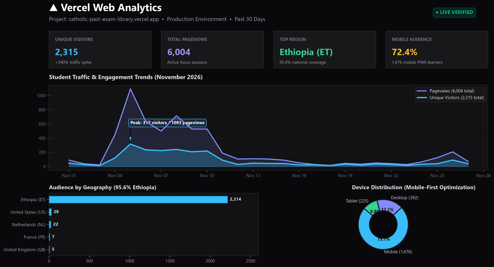

<div align="center">

# 📚 Past Exam Library & Focus Study Room
### *Ethiopia's Intelligent, Gamified & Offline-First Exam Prep Ecosystem (Grades 9–12)*

<p align="center">
  <a href="https://catholic-past-exam-library.vercel.app"></a>
  <a href="https://catholic-past-exam-library.vercel.app"></a>
  <a href="https://catholic-past-exam-library.vercel.app"></a>
  <a href="https://t.me/BGMCS1236"></a>
</p>

<p align="center">
  
  
  
  
</p>

---

<p align="center">
  <strong>Built for Ethiopian students, by students.</strong><br>
  An all-in-one split-screen desk combining past national exams, curriculum unit notes, Socratic AI coaching, and gamified Pomodoro focus sprints into an offline-resilient Progressive Web App.
</p>

</div>

---

## 📊 Live Web Analytics & Impact

> Verified real-time telemetry from **Vercel Web Analytics** demonstrating national reach and high daily student engagement across Ethiopia.

<div align="center">
  
</div>

<br>

| Metric | Production Data | Insight |
| :--- | :---: | :--- |
| 👥 **Unique Student Learners** | **2,315+** | Active secondary school candidates preparing for national and model exams. |
| 📖 **Total Study Pageviews** | **6,004+** | Cumulative deep revision sessions, practice drills, and note reads. |
| 🇪🇹 **National Reach (Ethiopia)** | **95.6%** | **2,214+ students** directly in Ethiopia utilizing the platform. |
| 📱 **Mobile-First Engagement** | **72.4%** | Highly optimized for lightweight, low-bandwidth smartphones (PWA). |
| ⚡ **Peak Daily Traffic** | **317 students / 1,093 views** | Concentrated study spikes during exam preparation cycles. |

---

## 🌟 Key Platform Features

```
┌────────────────────────────────────────────────────────────────────────┐
│                        SPLIT-SCREEN STUDY DESK                         │
├──────────────────────────────────┬─────────────────────────────────────┤
│ 📖 Upward Interactive Unit Deck  │ 🤖 Archie: Socratic AI Study Coach  │
│ 📌 Core Rules & Concept Outlines │ 💡 Hints, Clues & Formula Reminders │
│ 📐 High-Yield Formula Cheatcards │ ⏱️ 25-Min Pomodoro Sprint Counter   │
│ ⚠️ Common Traps & Pitfall Warnings│ 🔥 Daily Streak & XP Leaderboards   │
│ 💬 Peer Study Notes & Community   │ ⚔️ 1v1 Telegram Study Duels         │
└──────────────────────────────────┴─────────────────────────────────────┘
```

### 1. 🎯 Split-Screen Focus Study Room
- **Left Desk**: Read official PDF exam papers, curated unit summaries, and high-yield formula cheatsheets.
- **Right Desk**: Interact with Archie (AI Study Mentor), practice instant-validation questions, and auto-save revision notes.
- **Responsive Geometry**: Fluidly shifts from dual-column widescreen workstations to single-touch swipe cards on mobile.

### 2. 📖 Upward Interactive Unit Notes Deck
Flip seamlessly through 5 high-yield revision modules without endless vertical scrolling:
- 📌 **Overview**: Core rules, syllabus outlines, and fundamental concepts.
- 📐 **High-Yield Formulas**: Must-memorize equations with one-click copy.
- 💡 **National Exam Worked Examples**: Real Ethiopian exam questions solved step-by-step with final answer badges.
- ⚠️ **Examiner Traps & Common Pitfalls**: Critical warning signs and mistakes to avoid under exam pressure.
- 💬 **Student Notes & Community Tips**: Open crowd-sourced insights from peers.

### 3. 🤖 Archie: Socratic AI Study Coach & Mentor
- **Socratic Pedagogy**: Guides students step-by-step with progressive hints, clues, and formula prompts instead of spoiling final answers.
- **Dual Engine Architecture**: Runs **100% offline out-of-the-box** using built-in Ethiopian curriculum heuristics, with seamless cloud Google Gemini API integration.
- **Unit Quizzing**: Request on-demand diagnostic quizzes for any completed topic.

### 4. ⏱️ 25-Minute Focus Pomodoro Sprint Timer
- **Structured Sprints**: Default 25-minute focus blocks paired with 5-minute rejuvenation intervals.
- **Live Tab Countdown**: Dynamically updates the browser tab title (e.g. `(24:35 min) 🎯 Focus Study Room`) so students stay mindful while referencing other tabs.
- **Tactile Visual Feedback**: Calming pulsing focus glow while timer is actively running.

### 5. 🔥 Gamified Learning & Classmate Duels
- **Daily Study Streaks**: Earn fire flame badges (`🔥 7d`) and XP for daily focus sprints and practice drills.
- **Shared Streaks with Friends**: Invite classmates, maintain shared streaks, and send study nudges.
- **⚔️ 1v1 Telegram Study Duels**: Challenge classmates directly via Telegram to quick 5-question exam battles.

### 6. 📱 100% Offline Progressive Web App (PWA)
- Powered by Service Worker (`v2.2.0`).
- Installable on **Android**, **iOS**, **Windows**, and **macOS**.
- Study notes, formulas, practice questions, and the local AI engine continue functioning smoothly without active WiFi or mobile data.

---

## 🛠️ Technology Stack

<div align="center">

| Domain | Technologies |
| :--- | :--- |
| **Frontend UI** | Modern Vanilla JavaScript (ES6+), Glassmorphic CSS3, Responsive Flex/Grid |
| **PWA & Offline** | Service Worker API (Cache-First Strategies), LocalStorage, Web App Manifest |
| **Backend & APIs** | Node.js, Express.js REST Endpoints |
| **Hosting & Cloud** | Vercel Serverless Hosting, Vercel Web Analytics |
| **Database** | JSON File Persistence / LocalStorage / Supabase integration ready |
| **AI Engine** | Local Ethiopian Curriculum Heuristic Engine + Google Gemini API |

<br>

<p align="center">
  
</p>

</div>

---

## 🚀 Quick Start (Local Development)

### Prerequisites
- [Node.js](https://nodejs.org/) (v18.0 or newer recommended)
- `npm`

### Installation

```bash
# 1. Clone the repository
git clone https://github.com/Kidus-yahun/past-exam-library.git
cd past-exam-library

# 2. Install dependencies
npm install

# 3. Start local development server
npm start
# or with live reload:
npm run dev
```

Visit [http://localhost:3000](http://localhost:3000) in your browser.

---

## 🔐 Access & Security Roles

- **Student Access**: Free open registration directly on the platform or 1-click Google Sign-In.
- **Guest Access**: Instant 1-click access to all public past exams, unit study desk, and offline AI coach without logging in.
- **Administrator Access**: Protected via server environment variable (`ADMIN_PASSWORD`). Set `ADMIN_PASSWORD` in your Vercel project environment settings to access the management portal.

---

## 📡 Key API Endpoints

| Method | Endpoint | Description |
| :--- | :--- | :--- |
| `GET` | `/api/topic-notes` | Fetch community notes for a specific grade, subject, and unit |
| `POST` | `/api/topic-notes` | Contribute a new peer study tip or shortcut (+20 XP) |
| `POST` | `/api/topic-notes/:id/like` | Upvote a helpful peer note |
| `POST` | `/api/ai-tutor` | Query Archie (AI Study Mentor) with question context |
| `GET` | `/api/exams` | Filter and retrieve past exam papers |
| `POST` | `/api/exams` | Upload new PDF exam paper *(Admin only)* |
| `GET` | `/api/practice` | Retrieve practice questions by grade, subject & unit |

---

## 👥 Community & Telegram Channel

Join the official Telegram community for newly uploaded model exams, national exam answer keys, and study group discussions:

👉 **Telegram Channel**: [@BGMCS1236](https://t.me/BGMCS1236)  
👉 **Live Web Platform**: [catholic-past-exam-library.vercel.app](https://catholic-past-exam-library.vercel.app)

---

## 👨‍💻 Author & Acknowledgements

Created with ❤️ by **[Kidus Yahunsew](https://github.com/Kidus-yahun)** for Ethiopian high school students.

Released under the [ISC License](LICENSE).
